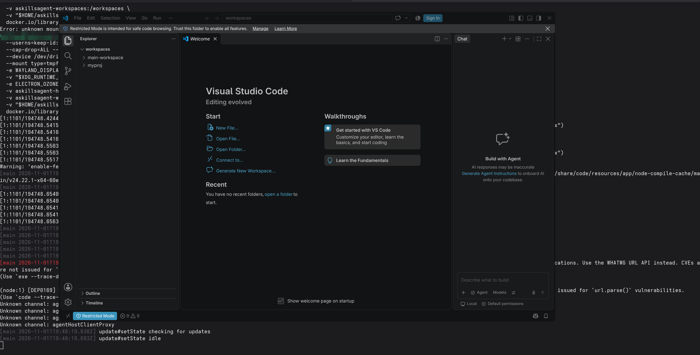
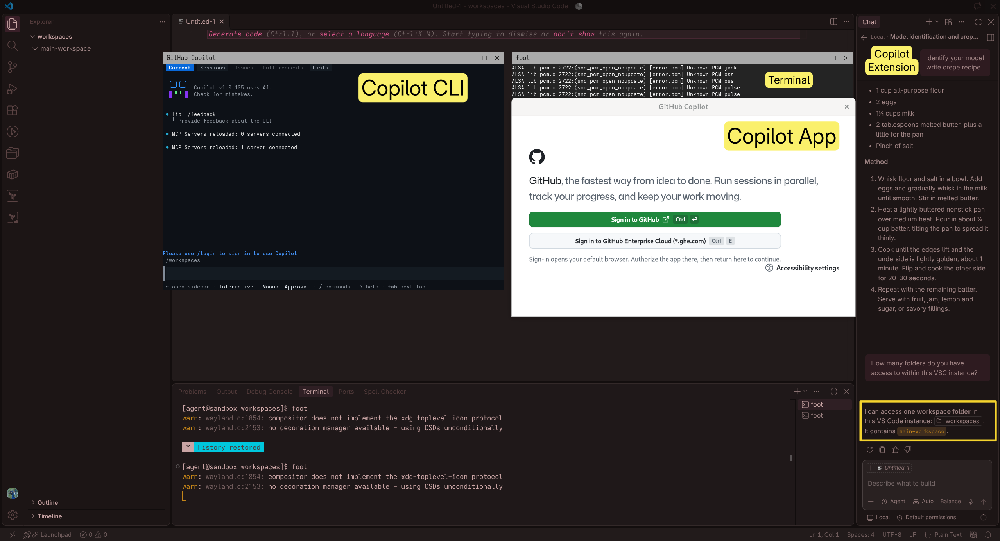

This skills bundle has been generated using ['A-Skills'](https://github.com/a-matthew/a-skills).

## Metadata
<!-- - Author: {author-profile-name}/{author-alias}. -->
- Name: 'A-Skills'.
- Purpose: Enforcing agent skills in a windowed sandbox.
- Format: Docker Container / 'Agent Skills' framework.
- License:
  - This project's license: [GNU General Public License v3.0](LICENSE)
  <!-- - Dependency-1: [{dependency-name}({license-1-name})] -->
  <!-- - Dependency-2: [{dependency-name}({license-2-name})] -->

## Setup
### Dependencies:
  - None (Any OS, no-isolation)
  - Gnome Boxes/VM (Linux, full-isolation)
  - Podman/Container (Linux, full isolation)

### Installation:
- clone the repository duh
- (optionally) rename the folder to .github or .claude or .agents, depending on the harness, per
[documentation](https://docs.github.com/en/copilot/how-tos/copilot-on-github/customize-copilot/customize-cloud-agent/add-skills) by GitHub.
- (optionally) adjust Visual Studio Code settings per settings.json snippet (done automatically for the container-sandboxed agent).
#### Linux-only
- (optionally) install Gnome Boxes (e.g. Flathub)
- (optionally) install Podman Desktop (e.g. Flathub)
  - check whether the Podman socket is running
    - `systemctl --user enable podman.socket`
    - `systemctl --user start podman.socket`
    - `systemctl status --user podman.socket`
      

      
In case the socket is dead...

      - the command starts Podman Desktop (Flatpak) in CLI mode with an `ls` command to read the socket, the `spawn` command creates a test podman process.
      - `flatpak run --command=sh io.podman_desktop.PodmanDesktop -c \
  'ls -l $XDG_RUNTIME_DIR/podman/; flatpak-spawn --host podman --version'`
      - test if there any any stale connections using `podman system connection list`
      - if nothing seems wrong then congrats. Perhaps like myself you managed to spawn so many processes on the OS that system has random issues. I ocassionally experience this in GitKraken's [`"file watching failed to start for this repository"`](https://help.gitkraken.com/gitkraken-desktop/common-issues/#file-watching-failed-to-start) error, but also with Gnome system monitor's `"Unable to find default local file monitor type"`.
      - close some VSC instances, browser windows, or restart the host. Essentially increase `fs.inotify.max_user_watches` and `fs.inotify.max_user_instances`, per my [article](https://blog.amatthew.eu/diagnosing-podman-desktop).

      

  - build image using Podman with `Dockerfiles/` as the context directory.

### Usage:
  - no-isolation
    - In this mode the skills in this repository can be used as-is and the agents roam free across the entire host operating system, performing the magic of `rm` or alike on random files :thumbsup:.
  - Gnome Boxes
    - In this mode the skills in this repository can be used inside a VM. Gnome Boxes offers the majority of Linux distributions on a drop-down list. The operator can select which files on the host are shared with the guest OS. This is **not** a very performant setup, as there is significant lag and also I/O issues when operating inside guest OS's VSC and CLIs. Mostly *click-ops* type of setup.
    - However, this option supports simple host-mirrored configuration of the IDE and support software, along with compatibility with immutable distributions and Flatpaks.
  - Podman (container)
    - In this mode the skills in this repository can be used inside a container. Podman may build the included .Dockerfile with dependencies for Visual Studio Code with GitHub Copilot extension, GitHub Copilot App, GitHub Copilot CLI.
    - Most likely the ideal solution, as folders can be mounted directly to the container, while elevating the native Wayland display server. The concept offers supreme convenience at low risk.
    - This mode supports multiple entrypoints, e.g. `code`, `browser`, `copilot`, `copilot-cli`.

## Example
### Podman (container)
Visual Studio Code instance before logging in, right after provisioning.

Visual Studio Code instance after logging in, ready for work.
