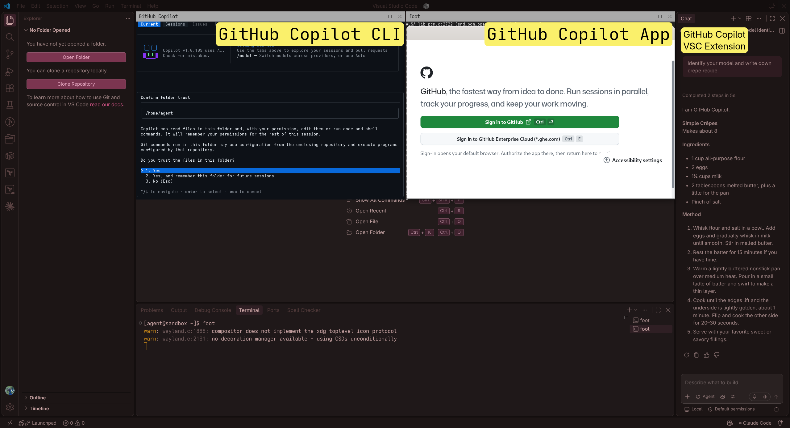
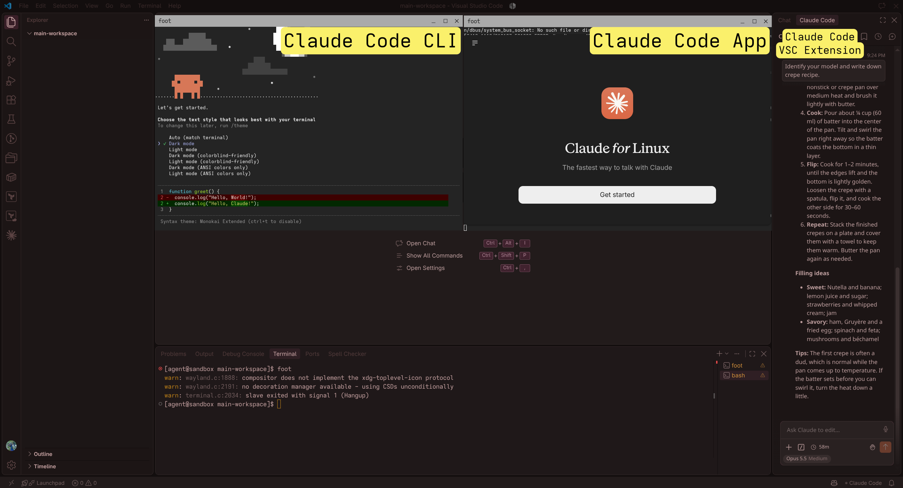

<sup>This skills bundle has been generated using ['A-Skills'](https://github.com/a-matthew/a-skills).</sup>

# A-Skills

## Metadata
<!-- - Author: {author-name}/{author-alias}. -->
- Name: 'A-Skills'.
- Purpose: Enforcing agent skills in a windowed sandbox.
- Format: Docker Container / Agent Skills framework.
- License:
  - This project's license: [GNU General Public License v3.0](LICENSE.md)
  <!-- - Dependency-1: [{dependency-name}({license-1-name})] -->
  <!-- - Dependency-2: [{dependency-name}({license-2-name})] -->

## Features
- Bundled skills:
  - 'style': answer length, text formatting, comments, references, `CHANGELOG.md` and `CODEOWNERS` conventions.
  - 'ops': naming notation and Terraform conventions.
  - 'obsidian': Obsidian Markdown conventions.
- Two container images: GitHub Copilot and Claude Code, each with Visual Studio Code, the desktop app and the CLI.
- Hardened container: runs with `--cap-drop=ALL` and `no-new-privileges`, with only the selected folders mounted.
  - `--userns=keep-id` maps the container's 'agent' user to the host user, so root inside the container is not root on the host.
  - Only the chosen folders are mounted, and `/run/user/1000` is an in-memory `tmpfs` that disappears with the container.
  - `--security-opt label=disable` turns off SELinux labelling, because the default labels block the Wayland socket and `/dev/dri`, which the window needs. The isolation above still applies.
- Native Wayland window passthrough, without X11.
- Pre-configured Visual Studio Code settings, documented in [SETTINGS.md](Dockerfiles/SETTINGS.md).

## Setup
### Dependencies
  - None (Any OS, no isolation)
  - Gnome Boxes/VM (Linux, full isolation)
  - Podman/Container (Linux, full isolation)

### Installation
- clone the repository <sub>duh</sub>
- (optionally) rename the folder to `.github` or `.claude` or `.agents`, depending on the harness, per
[documentation](https://docs.github.com/en/copilot/how-tos/copilot-on-github/customize-copilot/customize-cloud-agent/add-skills) by GitHub.
  - e.g. Claude Code only loads skills natively from the `.claude/skills` directory. They still work just fine through the `AGENTS.md` instructions.
- (optionally) adjust Visual Studio Code settings per the `settings.json` snippet (pre-loaded automatically for the container-sandboxed agent).
  - **these settings are overwritten by the user-specific `settings.json` file synchronised from the logged-in user!**
#### Linux-only
- (optionally) install Gnome Boxes (e.g. Flathub)
- (optionally) install Podman Desktop (e.g. Flathub)
  - check whether the Podman socket is running
    - `systemctl --user enable podman.socket`
    - `systemctl --user start podman.socket`
    - `systemctl status --user podman.socket`
      - if the socket is dead, see [Troubleshooting](#troubleshooting).
  - build the image using Podman with `Dockerfiles/` as the context directory.
    ```bash
    # Replace 'Copilot' with 'Claude' for the Claude Code image
    podman build -f Dockerfiles/Copilot/askillsAgent.dockerfile \
      -t docker.io/library/askillsagent Dockerfiles/
    ```
  - run the image using the `podman run` command from [Dockerfiles/README.md](Dockerfiles/README.md#podman).
  - share files with the agent by placing them in the host's `$HOME/askillsagent` directory, which is mounted as `/workspaces/main-workspace` inside the container.

### Usage
`AGENTS.md` tells the agent which skill to apply and when, while `CLAUDE.md` imports it for Claude Code. Each `SKILL.md` holds the general rules and points to its extension files, which the agent reads only when the task requires them.

To add a custom skill, create a new folder under `.github/skills/` with a `SKILL.md` file (with `name` and `description` in its frontmatter), then reference it in `AGENTS.md`.

The skills can be used in one of the following modes:
  - 'no isolation'
    - In this mode the skills in this repository can be used as-is and the agents roam free across the entire host operating system, performing the magic of `rm` or the like on random files :thumbsup:
  - Gnome Boxes
    - In this mode the skills in this repository can be used inside a VM. Gnome Boxes offers the majority of Linux distributions in a drop-down list. The operator can select which files on the host are shared with the guest OS. This is **not** a very performant setup, as there are significant lag and I/O issues when operating inside the guest OS's VSC and CLIs. Mostly a 'click-ops' type of setup.
    - The setup of the VM is on the Operator. This repository does not cover it.
    - This option supports simple host-mirrored configuration of the IDE and support software, along with compatibility with immutable distributions and Flatpaks.
  - Podman (container)
    - In this mode the skills in this repository can be used inside a container. Podman may build one of the included `.Dockerfile` images:
      - GitHub Copilot: Visual Studio Code with the GitHub Copilot extension, the GitHub Copilot App and the GitHub Copilot CLI.
      - Claude Code: Visual Studio Code with the Claude Code extension, the Claude Desktop App and the Claude Code CLI.
    - This is most likely the ideal solution, as folders can be mounted directly to the container, while leveraging the native Wayland display server. The concept offers supreme convenience at low risk.
    - This mode supports multiple entrypoints:
      - GitHub Copilot: `copilot-vsc`, `copilot-app`, `copilot-cli`, `browser`, `terminal`.
      - Claude Code: `claude-vsc`, `claude-app`, `claude-cli`, `browser`, `terminal`.

#### Repository structure
```
.
├── .github
│   ├── skills
│   │   ├── obsidian           # Obsidian Markdown conventions
│   │   ├── ops                # Naming notation, Terraform
│   │   └── style              # General styling rules
│   ├── CHANGELOG_TEMPLATE     # Template for CHANGELOG.md
│   └── CODEOWNERS_TEMPLATE    # Template for CODEOWNERS
├── Dockerfiles
│   ├── Claude                 # Claude Code image and entrypoint
│   ├── Copilot                # GitHub Copilot image and entrypoint
│   ├── SETTINGS.md            # Visual Studio Code settings reference
│   └── vsc-settings.json      # Pre-loaded Visual Studio Code settings
├── AGENTS.md                  # Skill workflow for all agents
└── CLAUDE.md                  # Imports AGENTS.md for Claude Code
```

## Example
### Podman (container)
Visual Studio Code instance before logging in, right after provisioning.


A Visual Studio Code instance after logging in, with user's `settings.json`.




## Troubleshooting
### Podman socket
<details>
<summary>socket unresponsive</summary>

- the command starts Podman Desktop (Flatpak) in CLI mode with an `ls` command to read the socket; the `spawn` command creates a test Podman process.
- ```bash
  flatpak run --command=sh io.podman_desktop.PodmanDesktop -c \
    'ls -l $XDG_RUNTIME_DIR/podman/; flatpak-spawn --host podman --version'
  ```
- test if there are any stale connections using `podman system connection list`
- if nothing seems wrong, then congrats. Perhaps, like me, you managed to spawn so many processes on the OS that the system has random issues. I occasionally experience this in GitKraken's ["file watching failed to start for this repository"](https://help.gitkraken.com/gitkraken-desktop/common-issues/#file-watching-failed-to-start) error, but also in Gnome system monitor's "Unable to find default local file monitor type".
- close some VSC instances or browser windows, or restart the host. Essentially increase `fs.inotify.max_user_watches` and `fs.inotify.max_user_instances`, per my [article](https://blog.amatthew.eu/diagnosing-podman-desktop).

</details>
